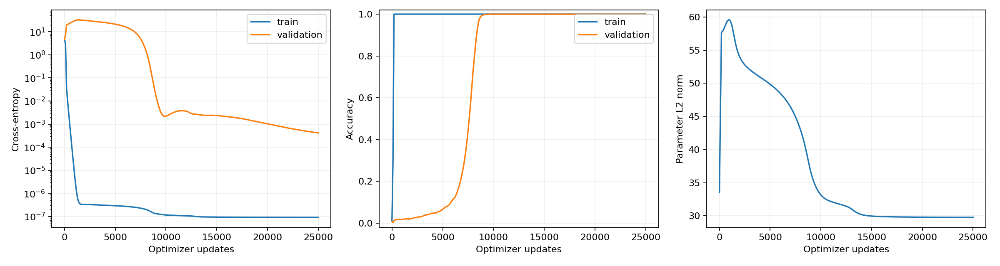

# Grokking Research Lab

A reproducible study of **delayed generalization in modular addition** using a small causal Transformer. The completed reference-aligned run shows grokking under the project's declared criterion: the model fits its training examples early and succeeds on held-out validation pairs much later.

[Open in Colab](https://colab.research.google.com/github/yashwanth510/grokking_lab/blob/main/notebooks/Grokking_Research_Lab.ipynb) · [Results report](reports/REFERENCE_RESULTS.md) · [Model checkpoints](https://github.com/yashwanth510/grokking_lab/releases/tag/reference-v1) · [GitHub Actions](https://github.com/yashwanth510/grokking_lab/actions)



## Results and project status

| Measurement | Original pilot | Reference-aligned run |
| --- | ---: | ---: |
| Initialization seed | 0 | 999 |
| Training updates | 30,000 | 25,000 |
| Final training accuracy | 81.04% | **100%** |
| Final validation accuracy | 63.02% | **100%** |
| Sustained 99% training crossing | Not reached | **Step 200** |
| Sustained 99% validation crossing | Not reached | **Step 8,800** |
| Delay between crossings | Not observed | **8,600 updates** |

A crossing is the first of **three consecutive logged observations at or above 99% accuracy**. Logs are spaced 100 updates apart. This threshold is the project's operational definition; crossing times have that logging resolution.

In the successful run, training accuracy is already 100% at step 1,000 while validation accuracy is only 1.76%. Validation reaches 73.29% at step 8,000 and 100% at the final step. CPU evaluation of supplied checkpoints reproduces the final accuracies. The training run itself was performed on a Tesla T4 in Colab; its log records 228.77 seconds for training, logging and checkpointing, excluding the rest of the notebook.

**Completed:** both measured runs, checkpoint verification, learning curves, Fourier spectra, ordinary/shuffled probes across saved checkpoints, head ablations, embedding-frequency interventions, public model releases, automated checks and reproduction instructions.

**Remaining:** repeated seeds, controlled training-size/weight-decay comparisons, matched-energy intervention controls, full circuit reconstruction and final held-out test evaluation. This is one successful seed and condition. Several settings changed together, so the comparison does not identify a single cause of the improvement. The implementation is reference-aligned, not an exact paper reproduction or a claim of a novel circuit.

Detailed records:

- [Successful GPU run and interpretation](reports/REFERENCE_RESULTS.md)
- [Declared baseline protocol and reference deviations](reports/REFERENCE_BASELINE.md)
- [Original unsuccessful pilot](reports/RESULTS.md)
- [Successful run's machine-readable summary](results/reference_seed999/summary.json)
- [Checkpoint and split verification](results/reference_seed999/checkpoint_verification.json)

## What the project does

The task is to predict `(a + b) % 113` for integers `a` and `b` from 0 through 112. For example, `(110 + 7) % 113 = 4`. The code generates all **12,769 ordered pairs** and their exact labels; no dataset download, tokenizer, model download or API key is needed.

Each input is `[a, b, =]`. The numbers and equals sign have exact token IDs. Token and positional embeddings feed one causal attention block, an MLP and an output map that scores the 113 possible answers. The model is trained from random initialization; it is not given the addition formula as part of its forward computation.

The study asks when held-out performance appears and how it relates to the network's learned representations. Accuracy curves describe behavior. Probes and interventions investigate internal representations and component dependence.

## Run in Colab or Kaggle

Use the single self-contained [Grokking_Research_Lab.ipynb](notebooks/Grokking_Research_Lab.ipynb). The notebook keeps concise section labels and executable cells.

1. **Colab:** click [Open in Colab](https://colab.research.google.com/github/yashwanth510/grokking_lab/blob/main/notebooks/Grokking_Research_Lab.ipynb), select **Runtime → Change runtime type → GPU**, and save. **Kaggle:** import the notebook and select a GPU accelerator.
2. Choose **Run all**. Defaults run a 100-update smoke check, the 25,000-update reference-aligned experiment, validation analyses and checkpoint probes.
3. The final cell creates `grokking_lab_outputs.zip`. Colab starts a download; other notebook environments show the archive path and, when supported, a file link. Preserve the ZIP before ending the temporary runtime.

The notebook uses the environment's installed PyTorch, NumPy, pandas and matplotlib; it does not install this repository as a package. An available GPU and enough session time are needed for the default long run. The measured run's timing is not a runtime guarantee.

Setup switches:

| Setting | Default | Behavior |
| --- | --- | --- |
| `RUN_PILOT` | `True` | Run the reference-aligned baseline; set `False` for CPU smoke and smoke-model analysis only |
| `RUN_SWEEP` | `False` | Optional 15-run comparison across five conditions and three seeds |
| `FINAL_PROTOCOL_FROZEN` | `False` | Leave the final test untouched until experiment and analysis choices are frozen |
| `SMOKE_STEPS` | `100` | Short pipeline check; not evidence of grokking |
| `EXPERIMENT_NAME` | `reference_seed999` | Name of the full baseline run |

Outputs are written to `/content/grokking_lab_reference` in Colab, `/kaggle/working/grokking_lab_reference` in Kaggle, or `runs/reference` locally. These directories are separate from the original pilot. To resume a notebook run, restore the extracted `grokking_lab_reference` folder under `/content` or `/kaggle/working`, keep the configuration unchanged and run all cells again. Existing smoke and pilot checkpoints resume automatically. A completed checkpoint does not train again.

## Install and run locally

Use **Python 3.10 or later**. Long experiments benefit from a GPU; the smoke run and checkpoint analysis support CPU. Install a PyTorch build suitable for your hardware before installing the package if needed.

```bash
git clone https://github.com/yashwanth510/grokking_lab.git
cd grokking_lab
python -m venv .venv
source .venv/bin/activate
python -m pip install -e '.[dev]'
```

Run the short check and analyze its saved model:

```bash
python -m grokking_lab train --config configs/smoke.json --name smoke_seed0
python -m grokking_lab analyze --name smoke_seed0
```

Train the successful configuration from scratch:

```bash
python -m grokking_lab train --config configs/reference.json --name reference_seed999
```

If interrupted, use the identical configuration and output directory:

```bash
python -m grokking_lab train --config configs/reference.json --name reference_seed999 --resume
```

New CLI runs default to `runs/`; use `--output PATH` to choose another parent directory. Use a distinct `--name` for each experiment. Existing nonempty run folders are protected from accidental fresh-run overwrites. Published measurements in `results/` remain separate.

## Inspect the released model without training

The [reference-v1 release](https://github.com/yashwanth510/grokking_lab/releases/tag/reference-v1) contains the complete original output archive, a model card and SHA-256 checksums. The archive includes all **26 snapshots** from step 0 through step 25,000, `latest.pt` with optimizer state, split indices, configuration, history, environment, figures and probe tables.

Download through the release page, or use GitHub CLI:

```bash
mkdir -p runs/released_reference
gh release download reference-v1 --repo yashwanth510/grokking_lab --dir runs/released_reference
(cd runs/released_reference && sha256sum -c SHA256SUMS)
python -m zipfile -e runs/released_reference/reference_seed999_outputs.zip runs/released_reference
```

Analyze selected snapshots directly from that extracted run:

```bash
python -m grokking_lab analyze --output runs/released_reference/grokking_lab_reference --name reference_seed999 --checkpoints 0 1000 5000 10000 25000
```

This evaluates training/validation data, exports derived analyses and merges checkpoint summaries. It does not retrain the model or evaluate the final test set. `--all-checkpoints` analyzes every available snapshot and takes longer. The original published measurements are preserved in the repository.

The unsuccessful pilot is separately available in [pilot-v1](https://github.com/yashwanth510/grokking_lab/releases/tag/pilot-v1):

```bash
mkdir -p runs/pilot_seed0
gh release download pilot-v1 --repo yashwanth510/grokking_lab --dir runs/pilot_seed0
(cd runs/pilot_seed0 && sha256sum -c SHA256SUMS)
python -m grokking_lab analyze --name pilot_seed0 --all-checkpoints
```

Only initialization and final snapshots were supplied for the original pilot. Its intermediate states cannot be recovered. Load only trusted checkpoint files. Model binaries are distributed through releases and excluded from ordinary Git commits.

## Analysis outputs and findings

CLI analysis writes to `analysis/step_XXXXXX/` inside the selected run, with `analysis/checkpoint_summary.csv` for comparisons. To read weights from another directory, pass `--checkpoint-dir PATH` alongside the run's configuration and history. Notebook exports also include the final model's tables and figures at the run root.

| Artifact | Contents |
| --- | --- |
| `config.json`, `history.csv` | Exact configuration and measured training/validation observations |
| `learning_curves.png` | Loss, accuracy and parameter-norm curves |
| `embedding_spectrum.csv` or `.png` | Fourier energy across numeric-token embeddings |
| `probes_validation.csv` | Checkpoint, frequency, ridge penalty, seeds, ordinary and shuffled-control validation R² |
| `head_ablations_validation.csv` | Loss and accuracy after removing individual or all attention heads |
| `frequency_interventions_validation.csv` | Selected/random frequency sets, retained embedding energy, loss and accuracy |
| `summary.json` | Crossing times and/or checkpoint metrics, depending on the analysis stage |
| `split_indices.npz`, `*.pt` | Generated split identities and model/optimizer states; included in release archives |

In the successful run, keeping the five strongest nonzero embedding frequencies plus the mean preserves **100% validation accuracy** while retaining **96.47% of embedding energy**. Removing those frequencies drops accuracy to **0.90%**. The five random same-count controls achieve approximately **0.74–0.98%**. Removing all attention heads gives **0.86%** accuracy.

These results support dependence on the selected embedding representation under the specified interventions. Random controls do not match retained energy, projections can move representations off distribution, and the downstream network is unchanged. The results do not constitute a complete recovered arithmetic circuit. Linear probe scores measure accessible information, not proof that the model uses it in prediction.

## Configuration and evaluation protocol

| Setting | Successful configuration |
| --- | --- |
| Modulus / vocabulary / sequence length | 113 / 114 / 3 |
| Architecture | One causal block; width 128; four heads of width 32; ReLU MLP width 512 |
| Normalization / dropout | None / none |
| Training fraction / split seed / initialization seed | 0.30 / 2026 / 999 |
| Optimizer | Full-batch AdamW; learning rate 0.001; weight decay 1.0; betas `(0.9, 0.98)` |
| Initialization | Normal std `0.8/sqrt(128)` ≈ 0.07071 |
| Bias policy | MLP biases frozen at zero; other linear-map biases absent |
| Precision | Float32 model parameters; float64 loss computation |
| Horizon / logging / snapshots | 25,000 updates / every 100 / initialization and every 1,000 |
| Probe protocol | Frequencies 1–5; ridge penalty 0.01; shuffled-control seed 123 |
| Notebook checkpoint probes | Steps 0, 1,000, 5,000, 10,000 and 25,000 |

The deterministic split contains **3,830 training pairs, 2,553 validation pairs and 2,553 reserved test pairs**. Another 3,833 pairs remain unused by this 30% condition, allowing nested larger training subsets. Reversed commutative pairs can cross splits. Initialization and split seeds are separate; seed control does not promise identical numerical results across software/hardware.

`configs/pilot.json` preserves the original experiment: std 0.02, trainable MLP biases, float32 loss, initialization seed 0 and 30,000 updates. The reference-aligned run changes these settings together and preserves the original split. Native PyTorch parameter layout and random-draw order differ from TransformerLens. See the [reference comparison](reports/REFERENCE_BASELINE.md) for the complete deviations.

The optional sweep compares weight decay `{0.0, 0.1, 1.0}` at training fraction 0.30 and training fractions `{0.10, 0.30, 0.50}` at decay 1.0, deduplicating the shared baseline: five conditions × seeds `{0, 1, 2}` = 15 runs. Report failures as well as successes. Equal update budgets are not equal compute budgets. This sweep has not been measured.

The **final test remains unevaluated**. Once experiment and analysis choices are frozen, the explicit final-checkpoint command is:

```bash
python -m grokking_lab test --name reference_seed999 --protocol-frozen
```

Use `--output` to point to a restored run when necessary. The command uses the configured final snapshot and refuses to overwrite an existing `final_test.json`. Do not use test performance for tuning.

For an explicitly stopped diagnostic without changing the declared horizon, add `--stop-at 500` to `train`, then continue with `--resume`. To extend a completed horizon, create a separate exploratory run:

```bash
python -m grokking_lab extend --source runs/reference_seed999 --name reference_extended --steps 50000
```

The parent run is preserved. `extension.json` records the parent checkpoint checksum, original configuration, continuation step and changed horizon. An extension is a changed protocol, not part of the original fixed-horizon result.

## Reproducibility and development

The original and successful GPU environments are recorded under `results/environment.json` and `results/reference_seed999/environment.json`, respectively. Their `pip_freeze.txt` files are historical environment records rather than portable dependency locks. Archive hashes, source-code revision, snapshot identities and CPU verification are recorded with the successful run's results.

```bash
python -m pytest -q
python scripts/sync_notebook.py --check
```

Checks cover dataset labels and disjoint/nested splits, causal masking, FFT reconstruction, checkpoint loading, interrupted-versus-uninterrupted training, non-destructive horizon extension, probe exports, preservation of result provenance, notebook/CLI summary compatibility, and the portable notebook's smoke/analysis/export path and GPU guard. GitHub Actions installs CPU PyTorch, checks synchronization and runs the suite on pushes and pull requests.

The notebook is self-contained for upload. Its shared definitions are synchronized from `src/grokking_lab/core.py`; after changing those definitions or `configs/reference.json`, run:

```bash
python scripts/sync_notebook.py
```

Then run the checks and commit both source and notebook updates. Keep generated runs and model binaries out of source commits.

## Repository layout

```text
configs/                         Original smoke/pilot and reference settings
notebooks/Grokking_Research_Lab.ipynb  Single portable notebook
src/grokking_lab/                 Training, analysis and CLI
tests/                           Automated checks
scripts/                         Notebook synchronization and pilot-release preparation
results/pilot_seed0/              Original unsuccessful GPU pilot
results/reference_diagnostic/    Historical 500-step CPU diagnostic
results/reference_seed999/       Completed grokking run and verification
reports/                         Findings, interpretation and declared protocol
.github/workflows/               GitHub checks
```

`runs/`, caches, checkpoints, split archives and ZIP exports are ignored. Small measured tables, figures, configurations and reports are versioned. Code is provided under the [MIT license](LICENSE).

## References

- Nanda et al., [Progress measures for grokking via mechanistic interpretability](https://arxiv.org/abs/2301.05217).
- Neel Nanda, [Modular addition walkthrough](https://www.neelnanda.io/mechanistic-interpretability/modular-addition-walkthrough).
- [Pinned TransformerLens v1.6.0 training notebook](https://github.com/TransformerLensOrg/TransformerLens/blob/54d548de4995a1ecc5b01b9c03aceaf0966c0eb3/demos/Grokking_Demo.ipynb).
