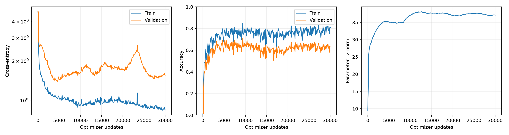

# Grokking Research Lab

Modular-addition experiments with a small causal Transformer, including training curves, Fourier analysis, probes and interventions. This is an independent, paper-inspired implementation.

The completed 30,000-step Colab pilot reached **81.04% training accuracy** and **63.02% validation accuracy** on a Tesla T4. Neither reached the sustained 99% threshold: **grokking was not demonstrated**. A local checkpoint evaluation reproduced the validation accuracy exactly. Multi-seed comparisons and final test evaluation have not been run.



See [the results report](reports/RESULTS.md) for measurements, controls and limitations.

## Run the notebook

Use the single notebook: [Grokking_Research_Lab.ipynb](notebooks/Grokking_Research_Lab.ipynb).

- **Colab:** upload it at [Google Colab](https://colab.research.google.com/), select **Runtime → Change runtime type → GPU**, then **Run all**.
- **Kaggle:** import the same file, select a GPU accelerator, then run all cells.

The notebook generates its own dataset and needs no external data or credentials. It uses installed PyTorch, NumPy, pandas and matplotlib. Setup controls are `RUN_PILOT = True`, `RUN_SWEEP = False` and `FINAL_PROTOCOL_FROZEN = False`. The default runs a 100-step smoke check, a 30,000-step pilot, validation analyses and an output ZIP export. For a CPU smoke run, set `RUN_PILOT = False`; analysis then uses the smoke checkpoint.

Outputs go to `/content/grokking_lab` in Colab, `/kaggle/working/grokking_lab` in Kaggle, or `runs` locally. The final cell downloads the ZIP in Colab or displays a file link elsewhere. Preserve the ZIP before ending a temporary runtime. To resume, restore its `grokking_lab` directory under `/content` or `/kaggle/working` and run again with unchanged settings; existing checkpoints resume automatically.

## Run locally

Use Python 3.10 or later and a PyTorch installation suitable for your hardware.

```bash
python -m venv .venv
source .venv/bin/activate
python -m pip install -e '.[dev]'
python -m pytest -q

python -m grokking_lab train --config configs/smoke.json --name smoke_seed0
python -m grokking_lab analyze --name smoke_seed0
```

New CLI runs go under `runs/`, separate from the published measurements in `results/`.

```bash
python -m grokking_lab train --config configs/pilot.json --name pilot_seed0
python -m grokking_lab train --config configs/pilot.json --name pilot_seed0 --resume
python -m grokking_lab analyze --name pilot_seed0
```

Load only trusted checkpoints. The downloaded model backup ZIP is retained separately from this repository; extract its three `.pt` files into `runs/pilot_seed0`, then copy `results/pilot_seed0/config.json` and `history.csv` there to analyze the measured model. Checkpoints are intentionally excluded from Git.

After freezing your experiment and analysis choices, final evaluation can be explicitly enabled:

```bash
python -m grokking_lab test --name pilot_seed0 --protocol-frozen
```

This uses the final fixed-horizon checkpoint and refuses to overwrite an existing `final_test.json`. Do not use the test set for tuning. The notebook's optional sweep contains five fraction/decay conditions across three initialization seeds; equal updates do not mean equal compute.

## Method

Inputs are `[a, b, =]` and labels are `(a+b) mod 113`. Split seed 2026 reserves 20% each for validation and test, with nested training subsets from the remaining pool. The pilot uses 30% of all input pairs. Reversed pairs can cross splits. Initialization seeds are separate from the split seed.

The model has one causal attention block and an MLP, no LayerNorm or dropout, width 128, four heads and MLP width 512. AdamW uses learning rate 0.001, betas `(0.9, 0.98)` and decay 1.0 on all trainable parameters. Training uses full batches and float32. Seed control does not guarantee identical results across software and hardware.

A crossing is the first logged step with at least 99% accuracy for three consecutive observations. Missing crossings indicate the threshold was not sustained within the budget. Fourier peaks and probes do not identify a causal circuit. Projection interventions can move the model off distribution, and random-frequency controls do not match retained energy. This is not a faithful reproduction of the cited paper.

## Repository

```text
configs/                  Smoke and pilot settings
notebooks/                One portable experiment notebook
src/grokking_lab/         Training and analysis package
tests/                   Automated checks
results/                  Measured GPU pilot, figures and environment
reports/RESULTS.md         Findings and limitations
.github/workflows/        GitHub checks
```

Temporary outputs, model binaries and caches are excluded by `.gitignore`. The full measured GPU environment is recorded in `results/pip_freeze.txt`; it is a historical environment record rather than a portable dependency lock.

## Push to GitHub

Create an empty GitHub repository, then run from this folder:

```bash
git init
git add .
git commit -m "Add modular-addition experiments and measured pilot results"
git branch -M main
git remote add origin https://github.com/YOUR_USERNAME/grokking-lab.git
git push -u origin main
```

## References

- Nanda et al., [Progress measures for grokking via mechanistic interpretability](https://arxiv.org/abs/2301.05217).
- Neel Nanda, [Modular addition walkthrough](https://www.neelnanda.io/mechanistic-interpretability/modular-addition-walkthrough).
